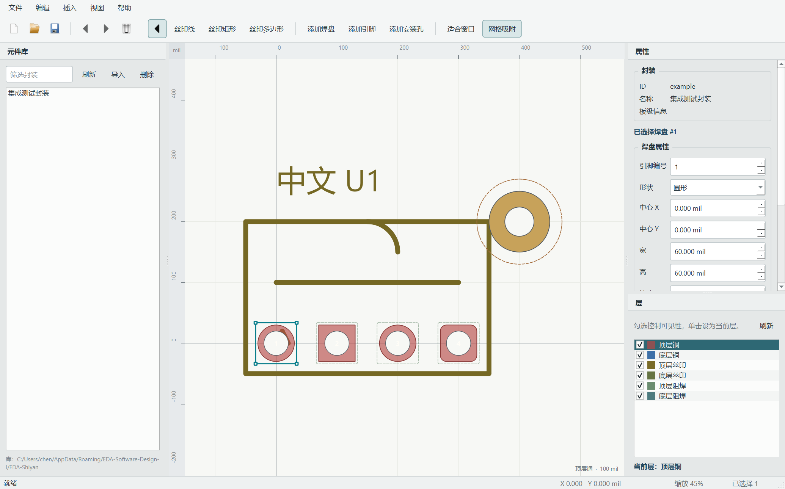
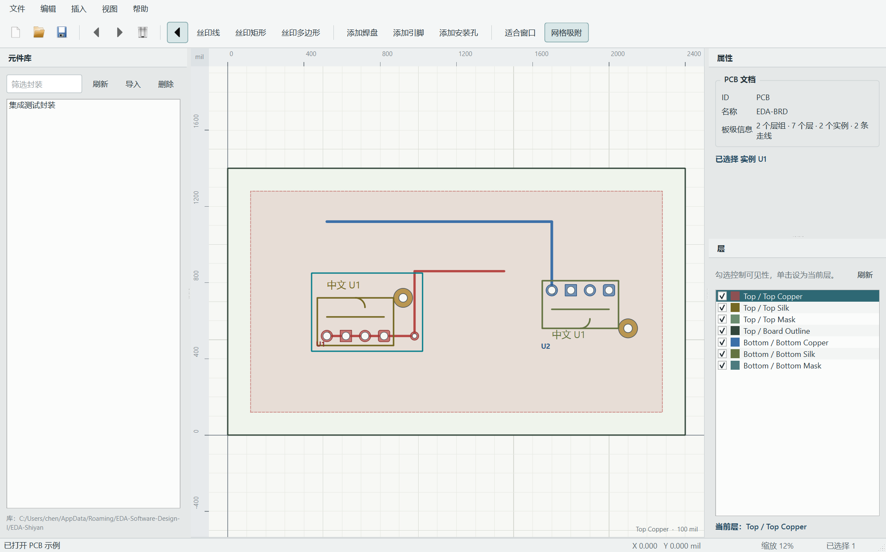

# B 模块测试记录

日期：2026-11-02

## 自动测试

目标：`test_b`

| 用例 | 验证内容 |
|---|---|
| `commandUndoRedo` | 封装编辑命令可撤销、重做并保持稳定 ID |
| `snappingAndSessions` | 网格吸附和非法会话选择清理 |
| `canvasRoundTripAndHitTest` | 屏幕/模型坐标往返误差和焊盘拾取 |
| `mainWindowHasBWorkflow` | 主窗口、动作、元件库、属性面板和层面板已创建 |
| `screenshotsAreNonBlank` | 1280×800 窗口截图包含有效多色内容 |
| `servicesDrivePanels` | 注入的库/图层服务驱动面板模型，默认图层模型为 6 行 |
| `validationServiceReportsIssues` | 校验服务对合法封装返回空列表，对非法结构返回 Error |
| `boardSnapshotUndo` | Board 实例移动命令可撤销/重做并保留对象 ID |
| `boardLayerServiceAndHitTest` | PCB 模式读取 7 个板层；实例、走线、覆铜命中和选中 |
| `boardFileRoundTrip` | 使用库 resolver 完成 EDA-BRD 编码、保存和重载一致 |
| `netlistImportBuildsBoard` | COMP/NET 解析、库校验、默认放置和重复导入去重 |

执行：

```powershell
$env:QT_QPA_PLATFORM='offscreen'
ctest --test-dir build-b --output-on-failure
```

结果：`test_core` 1/1、`test_b` 1/1 通过，`test_b` 共 11 个业务用例（13 passed，含 init/cleanup）。MinGW 和 MSVC 构建均通过；MSVC 使用本机 14.51 工具集，v143 仍需组内机器复核。

## 手工验收

| 步骤 | 预期 |
|---|---|
| 打开程序 | 自动加载 `exampleFootprint()`，画布显示四种焊盘、安装孔和五类丝印 |
| 点击焊盘 | 蓝色选择框出现，右侧属性面板显示该焊盘字段 |
| 修改形状/坐标/尺寸并应用 | 画布立即更新，可撤销和重做 |
| 拖动焊盘 | 拖动期间显示预览，松开后产生一条撤销命令 |
| 拖动右下角控制点 | 焊盘尺寸改变，可撤销 |
| 框选多个焊盘 | 状态栏显示选择数量，属性面板提示多选 |
| 切换图层可见性 | 对应层对象立即隐藏/显示 |
| 绘制丝印线和矩形 | 拖动预览，松开后加入模型 |
| 绘制多边形 | 右键或双击闭合，顶点少于三个时不提交 |
| 滚轮和中键 | 缩放中心不跳动，平移方向正确 |
| New/Open/Save | 打开失败不替换文档；保存失败不覆盖旧文件 |
| 服务注入 | 元件库和图层行来自注入模型；校验 Error 阻止保存，Warning 可确认继续 |
| 打开 PCB 示例 | 显示板框、7 个板层、2 个实例、两条走线、过孔和覆铜 |
| 点击/框选 PCB 对象 | 实例、走线、过孔和覆铜可选中并显示选择框 |
| 拖动 PCB 对象 | 松开后产生一条 Board 撤销命令 |
| 保存 `.brd` | 先执行 Board 校验，再用库 resolver 校验封装引用并原子保存 |
| 导入 `.net` | 验证元件和引脚；生成实例/网络；再次导入不重复创建 |
| 实验二默认启动 | `EDA_DEFAULT_BOARD_DEMO=ON` 时启动即进入 PCB 示例 |
| `Delete` | 焊盘及其关联引脚作为一条命令删除 |

## 视觉检查

已使用 Windows 原生 Qt 平台启动程序并截图检查：

- 中文字体正常。
- 左侧元件库、中央画布、右侧属性/图层面板没有互相遮挡。
- 画布中的 Y 轴、标尺、选择框和焊盘文字清晰。
- 1280×800 和实际 125% 缩放下布局可用。
- 截图保存在 `docs/images/b-main-window.png`。




